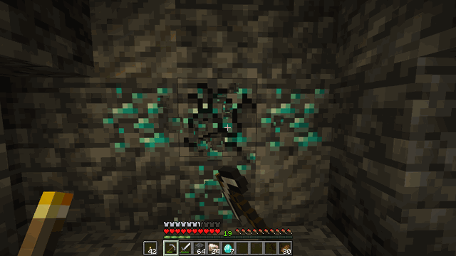

# DrinkingCraft

Un datapack que convierte Minecraft en un juego de bebida. Cada mineral que picas, jefe que derrotas o hito que alcanzas puede hacer que tú, o todo el servidor, tengan que beber o tomar un shot. Hecho para Minecraft Java Edition 26.3 (Wilderness Bound), pack format `121.0`. Inspirado en el antiguo "Drunkcraft", recreado desde cero para estar actualizado, ser confiable y estar en español. Hecho por EnzuBR.

## Cómo funciona

Cada evento funciona igual: aparece un título en pantalla, suena una alerta y un mensaje en el chat le avisa al servidor qué pasó y quién tiene que beber. Algunos eventos ocurren siempre, otros dependen de la suerte y algunos te dejan elegir a la víctima.

### Probabilidades jugando

Estos eventos no se activan siempre; primero tiran un dado. La minería es el gatillo principal (minerales normales o de pizarra profunda/deepslate, y Toque de seda siempre te protege en los minerales, excepto con la obsidiana), aunque matar a un animal indefenso también te puede jugar en contra.

| Gatillo | Probabilidad | Efecto |
| --- | :---: | --- |
| Picar Diamante | 25% | Todos beben, menos tú |
| Picar Esmeralda | 7.5% | Eliges a alguien para beber |
| Picar Oro (incluye Nether) | 7.5% | Eliges a alguien para beber |
| Picar Hierro | 4% | Eliges a alguien para beber |
| Picar Carbón | 3% | Eliges a alguien para beber |
| Romper Obsidiana (incluye Llorosa) | 5% | Bebes |
| Matar a un mob pasivo | 5% | Bebes |

### Hitos únicos

Estos solo ocurren una vez por mundo: el primer jugador en lograrlo activa el evento para todos (o elige a alguien) y no vuelve a dispararse.

| Hito | Efecto |
| --- | --- |
| Entrar al Nether | Todos beben |
| Encontrar una Fortaleza del Nether | Todos beben |
| Encontrar la Stronghold | Todos beben |
| Descubrir las Trial Chambers | Todos beben |
| Encontrar el bioma de Champiñones | Todos beben, menos tú |
| Primer intercambio con un Aldeano | Todos beben |
| Conseguir armadura completa de Diamante | Todos beben, menos tú |
| Entrar al End | Todos toman un shot |
| Matar al Ender Dragon | Todos toman un shot |
| Matar al Warden | Todos toman un shot, menos tú |
| Conseguir armadura completa de Netherite | Todos toman un shot, menos tú |
| Encontrar Ancient Debris | Eliges a alguien para tomar un shot |
| Conseguir una Elytra | Eliges a alguien para tomar un shot |
| Conseguir "De vuelta al remitente" (Ghast) | Eliges a alguien para tomar un shot |

### Siempre ocurren

Sin suerte ni "primer jugador": estos se activan para cualquier jugador, todas las veces.

| Evento | Efecto |
| --- | --- |
| Morir | Te terminas tu bebida |
| Sobrevivir 10 minutos sin morir | Bebes |
| Romper cualquier herramienta, arma, armadura o Elytra | Bebes |
| Usar un Tótem de la inmortalidad | Bebes |
| Entrar al servidor por primera vez | Tomas un shot |
| Primer jugador en conseguir una Mesa de crafteo | Tomas un shot |
| Primera Mesa de crafteo de los demás jugadores | 33% de probabilidad de beber |

## Desinstalación

Ejecuta `/function bebida:uninstall` antes de quitar el datapack para limpiar todos los scoreboards, etiquetas y logros que DrinkingCraft creó sin dejar rastros.

## Otros idiomas
  

---

EN:
# DrinkingCraft

DrinkingCraft turns Minecraft into a drinking game. Every ore you mine, boss you kill, and milestone you reach can send you, or the whole server, reaching for a drink. Built for Java Edition 26.3 (Wilderness Bound), pack format `121.0`. Inspired by the now-unavailable "Drunkcraft," rebuilt from scratch to be updated, reliable, and more fun. Made by EnzuBR.

## How it works

Every event fires the same way: a title flashes on screen, a sound plays, and a chat message tells the server what happened and who's drinking. Some events always trigger, others roll the dice, and a few let you pick your victim.

## Uninstalling

Run `/function bebida:uninstall` before removing the datapack, it cleans up every scoreboard, tag, and advancement DrinkingCraft added, so nothing lingers behind.

## Other languages
  
